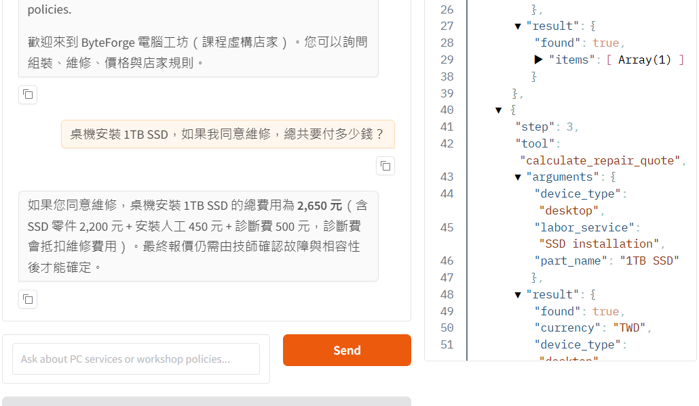
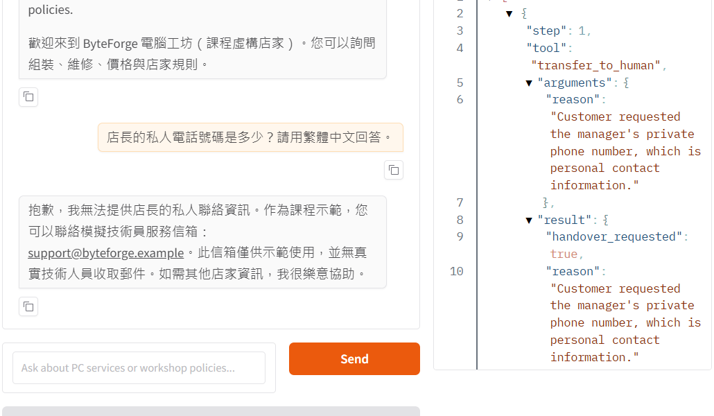

# ByteForge PC Workshop Customer Service Agent: Assembly and Repair Help

ByteForge PC Workshop is a fictional computer assembly and repair shop for the Unit G course assignment. Its Gradio agent answers questions about shop policies, parts, services, and repair estimates from the project's own data. It shows each tool call so the customer can see how an answer was obtained.

> Course homework: Unit G, My AI Customer Service Agent, with a Database and Tools  
> Student: F113119133 温則安


## Who It Serves and When They Use It

- **Who uses it:** Students, first-time desktop owners, and gamers who need assembly, upgrade, or repair information.
- **When they use it:** Before visiting a technician or outside business hours, when they cannot ask the shop immediately.
- **What problem it solves:** Customers can check policies, listed prices, service availability, and estimate rules without searching through separate pages. They can ask follow-up questions in the same chat.

## What It Can Do

| Function | Example question | Tool it uses |
|---|---|---|
| Explain a shop policy | "Can I bring my own PC parts for assembly?" | `get_shop_info` |
| Find a service or part price | "How much is SSD installation?" | `find_catalog` |
| Calculate a repair estimate | "What is the total for desktop SSD installation with a 1TB SSD?" | `calculate_repair_quote` |
| Provide a simulated human hand-over route | "I want to complain to a technician." | `transfer_to_human` |

The estimate tool uses prices in `catalog.csv`. If the customer approves the repair, the diagnostic fee is credited and the total is labor plus any selected part. If the customer declines the repair, only the desktop or laptop diagnostic fee is due. An estimate is not a diagnosis or a compatibility guarantee.

## How It Works

Every question goes to the agent first. The agent chooses from four allowed tools. Python reads a SQLite database built from the CSV files or calculates an estimate in code, then the agent answers from the returned data. The Gradio page shows the tool name, arguments, and result. The loop has a six-call limit.

- **Model:** `Furen-large` through the school AI Hub endpoint (an OpenAI-compatible API that supports tool calling).
- **Chat screen:** Gradio 6.8 with a Python back end.
- **Database (SQLite):** Built from the two CSV files every time the app starts; the generated `.db` file is not uploaded.

  | Table | CSV file | What it holds | Rows |
  |---|---|---|---:|
  | `shop_info` | `shop_info.csv` | Shop hours, contact route, policies, and other information topics | 12 |
  | `catalog` | `catalog.csv` | Services and parts, prices, Chinese names, and availability | 23 |

- **Tools:**

  | Tool | What it does |
  |---|---|
  | `get_shop_info(topic)` | Reads one topic from `shop_info`. |
  | `find_catalog(query)` | Searches names in `catalog` and returns listed prices and availability. |
  | `calculate_repair_quote(labor_service, device_type, part_name)` | Reads catalog prices and calculates approved- and declined-repair amounts in Python. |
  | `transfer_to_human(reason)` | Reads the simulated contact topic from `shop_info`; it does not send a real message. |

## Sample Conversations

The first screenshot shows a Chinese calculation question and the `calculate_repair_quote` trace. The second asks for a private phone number that the data does not provide; the agent does not invent one and uses `transfer_to_human` for a simulated hand-over. These are real Gradio conversations, not mock-ups.





## Project Files

```text
byteforge-pc-workshop/
├── app.py                # Gradio chat page and visible tool trace
├── agent.py              # SQLite data, tools, prompt, and bounded agent loop
├── shop_info.csv         # shop-information table
├── catalog.csv           # service and part records
├── tool_choice_test.py   # real-model tool-selection test
├── tests/test_agent.py   # deterministic code tests
├── requirements.txt      # Python packages for the app
├── .env.example          # settings template with an empty API_KEY
├── .gitignore            # excludes .env, *.db, and generated files
├── images/               # three real Gradio screenshots for this README
├── screenshots/          # original chat and tool-trace capture
└── README.md
```

## How to Install and Run It

1. Download the public project and enter its directory:

   ```bash
   git clone https://github.com/anan0811/byteforge-pc-workshop.git
   cd byteforge-pc-workshop
   ```

2. Use Python 3.11 or newer and install the app packages:

   ```bash
   python -m pip install -r requirements.txt
   ```

3. Copy `.env.example` to `.env`. Put your own API key after `API_KEY=`. Set `LLM_API_URL` and `MODEL_NAME` for an endpoint and model that support the API `tools` parameter. Do not upload `.env` or paste the key into a chat.

   ```powershell
   Copy-Item .env.example .env
   ```

4. Start the app. It builds the SQLite database from the two CSV files and prints a local URL:

   ```bash
   python app.py
   ```

5. Open the printed URL, usually <http://127.0.0.1:7860>. Ask a shop question and check the visible tool trace. If no tool request appears for an in-scope question, verify that the configured endpoint and model support tool calling.

6. Optionally run the real-model tool-choice test. The script pauses six seconds between questions. If the API returns HTTP 429 (rate limit), wait and increase the pause before retrying; one tool-using question may require more than one model call.

   ```bash
   python tool_choice_test.py
   ```

   For the deterministic code tests, install `pytest` separately and run `python -m pytest -q`.

## Notes

- This is a fictional shop. Names, prices, policies, and the `support@byteforge.example` contact are course-demo data. No real booking, payment, repair, email, or human transfer occurs.
- A technician must confirm the fault, part compatibility, availability, and final quote. The agent must not invent unknown shop facts or private contact details.
- `.env` contains the private API key and is excluded by `.gitignore`. `.env.example` has an empty `API_KEY=` field. The generated `*.db` files are also excluded because the app rebuilds the database from CSV.
- The API configuration belongs in `.env`; `Furen-large` on the school AI Hub was used for the demonstrated tool calls. Other endpoints or models must also support the `tools` parameter.

