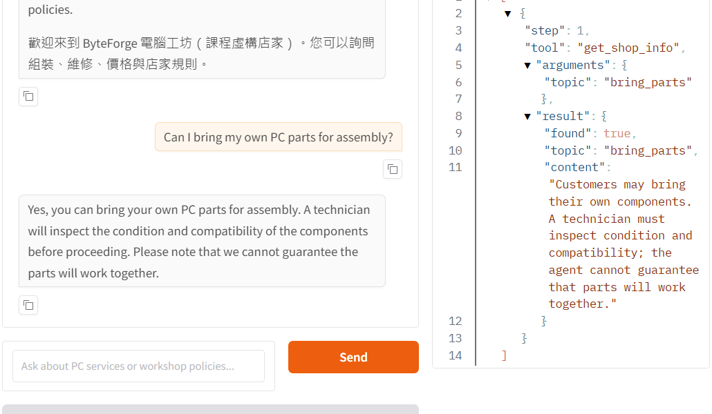

# ByteForge PC Workshop Customer Service Agent

ByteForge is a **fictional** computer assembly and repair shop built for the
Unit G customer-service assignment. Its Gradio chat agent answers policy and
price questions from a SQLite database, calculates repair estimates in Python,
and shows every tool call in a visible trace.

> Course homework: Unit G - AI Customer Service Agent with a Database and Tools

## Who It Serves

The demo serves customers who want to ask about computer assembly, repair,
upgrades, prices, and shop policies before visiting a technician. It does not
diagnose a device, verify part compatibility, take payment, make a booking, or
contact a real technician.

## What It Can Do

| Customer need | Example question | Tool |
|---|---|---|
| Shop policy | "Can I bring my own parts?" | `get_shop_info` |
| Service or part price | "How much is SSD installation?" | `find_catalog` |
| Repair estimate | "Desktop SSD installation with a 1TB SSD: how much?" | `calculate_repair_quote` |
| Human assistance | "I want to complain to a technician." | `transfer_to_human` |

The quote tool returns **two** outcomes: if the repair is approved, the
diagnostic fee is credited and the total is labor plus the selected catalog
part; if the repair is declined, only the desktop or laptop diagnostic fee is
due. The final diagnosis and part compatibility require a technician.

## Data and Architecture

Every customer turn goes to the model. The model chooses from an allowlist of
four tools. Python performs parameterized SQLite queries and arithmetic, then
returns structured data to the model. The chat page shows the tool name,
arguments, and result. The loop has a six-call limit.

| Table | Source CSV | Columns | Rows |
|---|---|---|---:|
| `shop_info` | `shop_info.csv` | `topic`, `content` | 12 |
| `catalog` | `catalog.csv` | `item_id`, `name`, `name_zh`, `category`, `price`, `available` | 23 |

The SQLite file is rebuilt from the two CSV files whenever the app starts.
Prices, policies, and contact details are invented for this course demo.
`support@byteforge.example` is not a real inbox.

## Screenshot

This live Gradio conversation shows the model's answer alongside the
`get_shop_info` call, arguments, and database result.



## Project Files

```text
byteforge-pc-workshop/
├── app.py                # Gradio chat and visible tool trace
├── agent.py              # SQLite data, tools, prompt, and bounded agent loop
├── catalog.csv           # service and part records
├── shop_info.csv         # store information topics
├── tool_choice_test.py   # 12-question real-model selection test
├── tests/test_agent.py   # deterministic code tests
├── screenshots/          # real chat and tool-trace screenshot
├── requirements.txt     # Python dependencies
├── .env.example          # settings template; contains no secret
├── .gitignore            # excludes .env and the generated database
└── README.md
```

## Install and Run

1. Use Python 3.11 or newer and install dependencies:

   ```powershell
   python -m pip install -r requirements.txt
   ```

2. Copy `.env.example` to `.env`. Set `LLM_API_URL`, `MODEL_NAME`, and
   `API_KEY` for an OpenAI-compatible endpoint and model that support tool
   calling. Never upload `.env` or paste its key into a chat.

   ```powershell
   Copy-Item .env.example .env
   ```

3. Start the app and open the local URL printed in the terminal:

   ```powershell
   python app.py
   ```

4. Run the automated code tests and, with the model endpoint running, the
   real tool-choice test:

   ```powershell
   python -m pytest -q
   python tool_choice_test.py
   ```

With the school AI Hub `Furen-large` model, the live 12-question tool-choice
test scored 12/12 after routing and calculation fixes. Results depend on the
configured model and endpoint; run the script again to verify your setup.

## Limitations and Safety

- This is a fictional shop; no real booking, payment, repair, or hand-over occurs.
- A technician must verify faults, compatibility, availability, and the final quote.
- No API key belongs in GitHub. The `.env` and generated `*.db` files are ignored.
- The code tests check database and loop behavior. The separate 12-question
  script is needed to measure a **real model's** tool-choice score.
